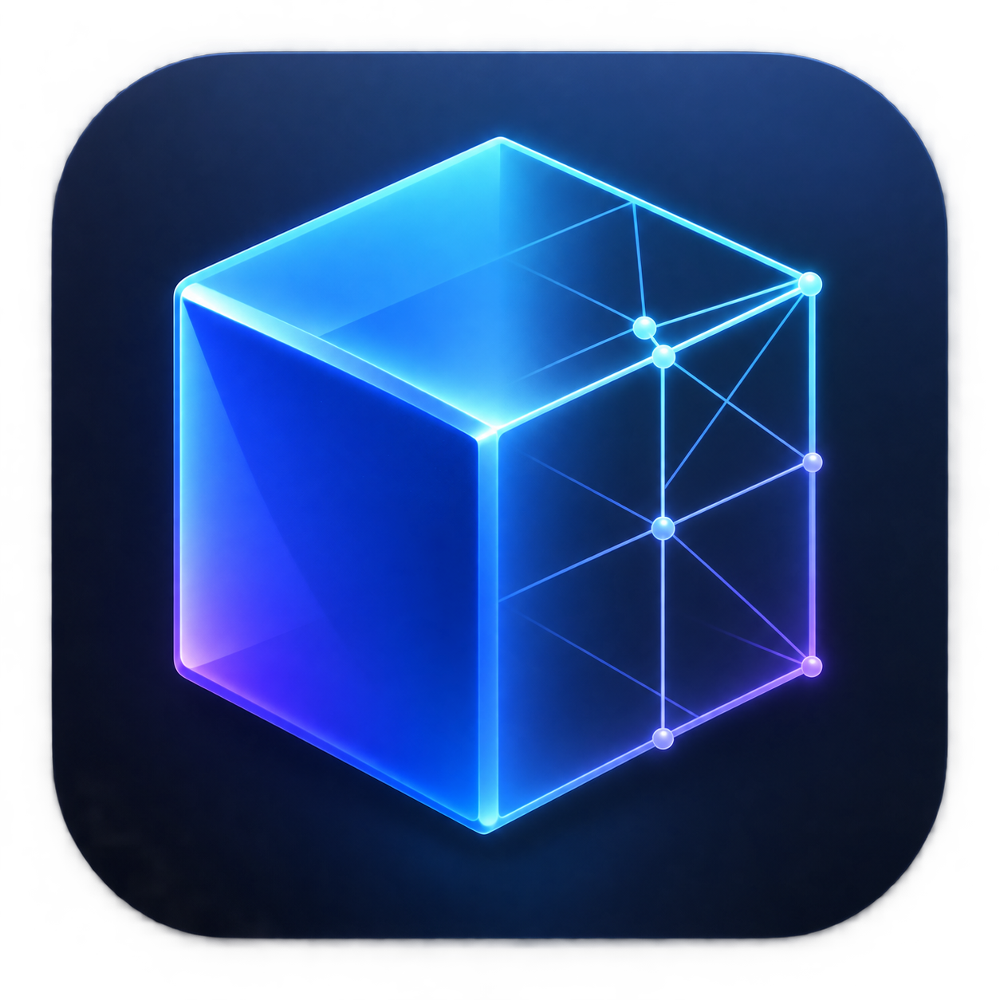
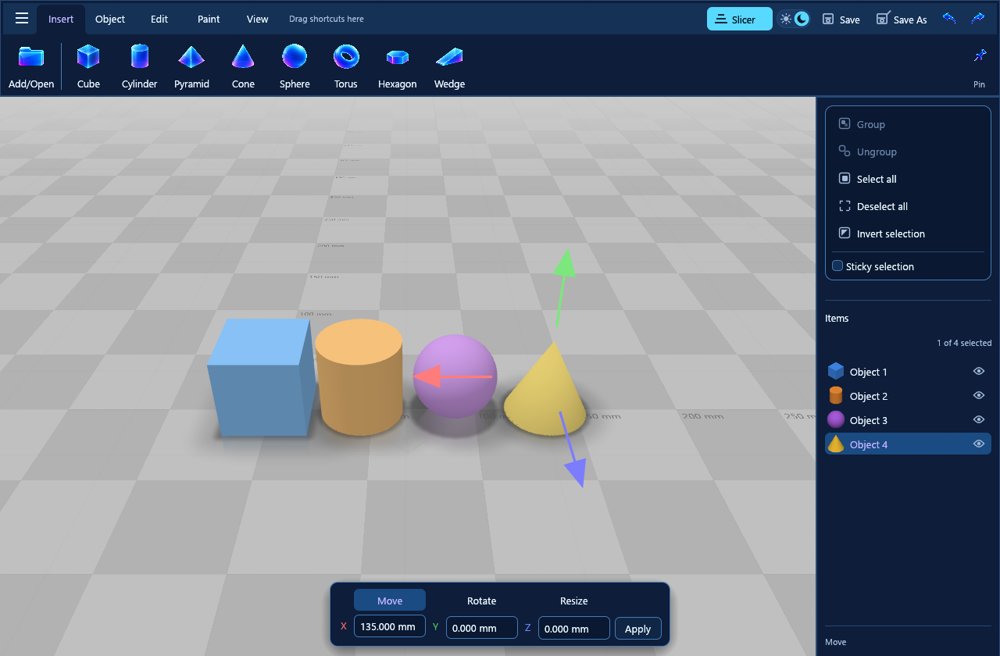
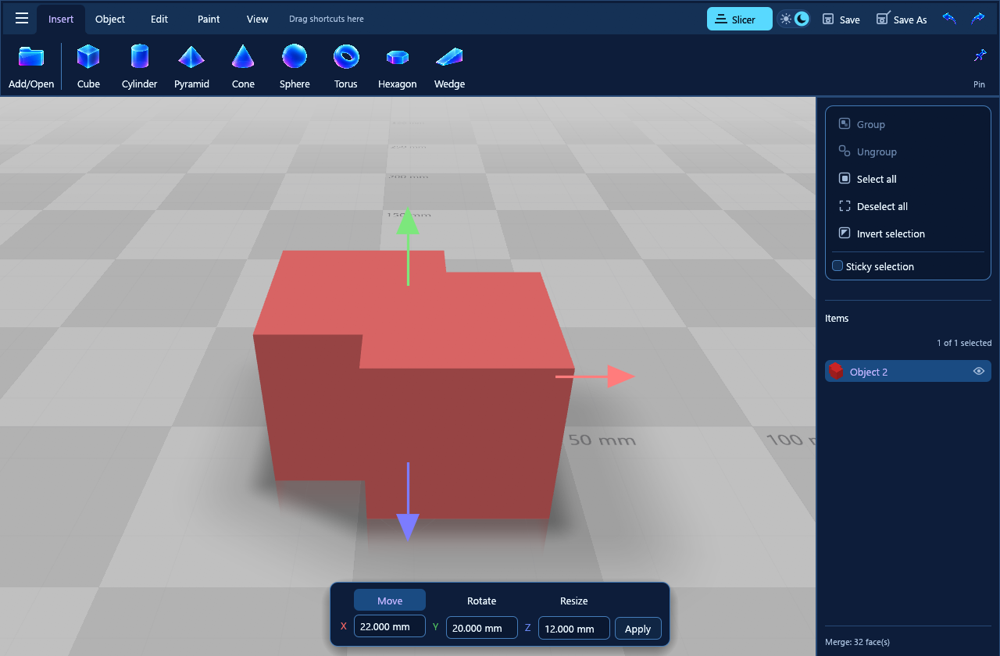
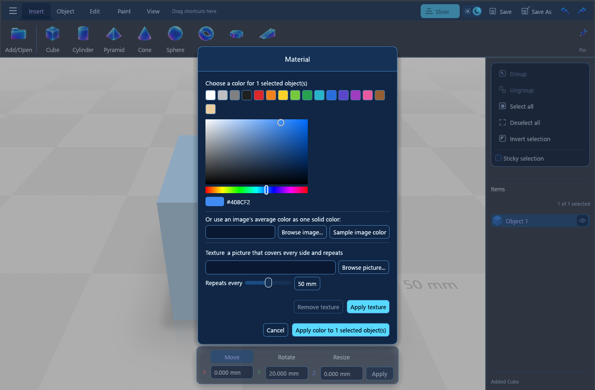
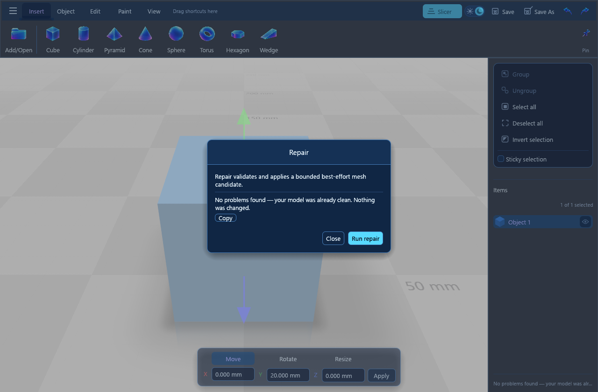
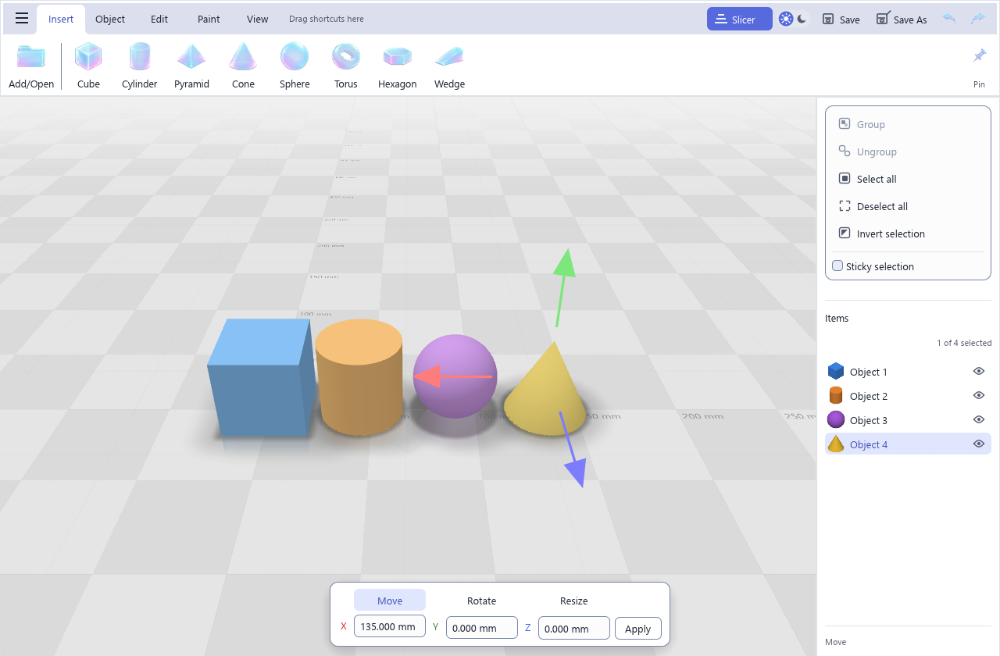

<p align="center">
  
</p>

<h1 align="center">3D Modeler</h1>

<p align="center">
  A simple, free 3D modeler for 3D printing. Windows, macOS and Linux.<br>
  Inspired by Microsoft 3D Builder, with an AI (MCP) server built in.
</p>

<p align="center">
  <a href="https://github.com/scotttheis/3D-Modeler/actions/workflows/ci.yml"></a>
  <a href="https://github.com/scotttheis/3D-Modeler/releases/latest"></a>
  <a href="LICENSE"></a>
</p>

<p align="center">
  
</p>

<!-- HERO-GIF: replace the picture above with a short demo GIF (see docs/launch-pictures.md, B1). -->

## Why

3D Builder was the easiest way to make something printable. It is gone from
most computers and never ran outside Windows. 3D Modeler keeps the same idea:
add shapes, move them, combine them, check them, print them. Nothing has to be
learned first. It is a small desktop app written in Rust, with no account and
no tracking.

## What it does

- **Shapes:** cube, cylinder, pyramid, cone, sphere, torus, hexagon and wedge.
- **Move, rotate and resize** with on-screen arrows or typed numbers in millimetres.
- **Combine:** Merge, Subtract and Intersect. Select one object and click
  Subtract to cut away everything it touches.
- **Edit meshes:** Grab, Smooth, Crease, Blob, Simplify, Subdivide, Hollow, Mirror, Align.
- **Print check:** finds holes and other problems and can repair them.
- **Look:** colours, textures, paint, X-ray and wireframe, light and dark themes.
- **Files:** opens and saves `.3dp` projects; imports and exports STL, OBJ, PLY,
  3MF and glTF/GLB (WRL on export).
- **Send to your slicer** from the toolbar.
- **AI built in:** an MCP server lets an assistant such as Claude use the same
  tools you do. See [`docs/mcp.md`](docs/mcp.md).

| Combine | Material | Print check |
|---|---|---|
|  |  |  |

Light theme:



## Download

Get the installer for your system from the
[Releases page](https://github.com/scotttheis/3D-Modeler/releases/latest).

| System | File | Notes |
|---|---|---|
| Windows | `3D-Modeler-<version>-windows-x86_64.msi` | Not code-signed, so Windows SmartScreen shows "More info", then "Run anyway". |
| macOS | `3D-Modeler-<version>-macos-universal.dmg` | Not notarized. Right-click the app, choose Open, then Open again. |
| Linux | `3D-Modeler-<version>-linux-x86_64.tar.gz` | Unpack it and run the installer script or launcher inside. |

The app checks GitHub once at startup for a newer version and asks before
downloading anything. Releases also carry `3D-Modeler-SHA256SUMS.txt` so you
can verify a download.

## Build from source

You need the Rust toolchain pinned in `rust-toolchain.toml`, a C toolchain and
libclang. See [`docs/building.md`](docs/building.md).

```
cargo build --release
target/release/modeler3d-app
```

On Windows, run `scripts/Initialize-BuildClang.ps1` in the same PowerShell
session before Cargo. Run the tests with `cargo test --workspace`.

## Use it with an AI assistant

The desktop app runs a local server that only your own computer can reach. The
`r4_mcp` program connects an MCP client to it, with four safety profiles
(observe, model, files, full) and file access limited to folders you approve.
Setup and the full tool list are in [`docs/mcp.md`](docs/mcp.md).

## Status

Version 1.0 is out. Known limit: very dense models (hundreds of thousands of
faces) can still make the window pause for a few seconds during a boolean
operation. Current work is tracked in [`docs/STATUS.md`](docs/STATUS.md) and
changes in [`CHANGELOG.md`](CHANGELOG.md).

## Contributing

Bug reports are very welcome. Because the product stands on extreme
simplicity, new features and look changes are considered one at a time. Read
[`CONTRIBUTING.md`](CONTRIBUTING.md) first. Security problems: see
[`SECURITY.md`](SECURITY.md).

## Licence

Licensed under the Apache License, Version 2.0. See [`LICENSE`](LICENSE) and
[`THIRD_PARTY_NOTICES.md`](THIRD_PARTY_NOTICES.md).

## Disclaimer

3D Modeler is an independent project. It is not affiliated with, endorsed by
or sponsored by Microsoft. 3D Builder is a trademark of Microsoft Corporation.
