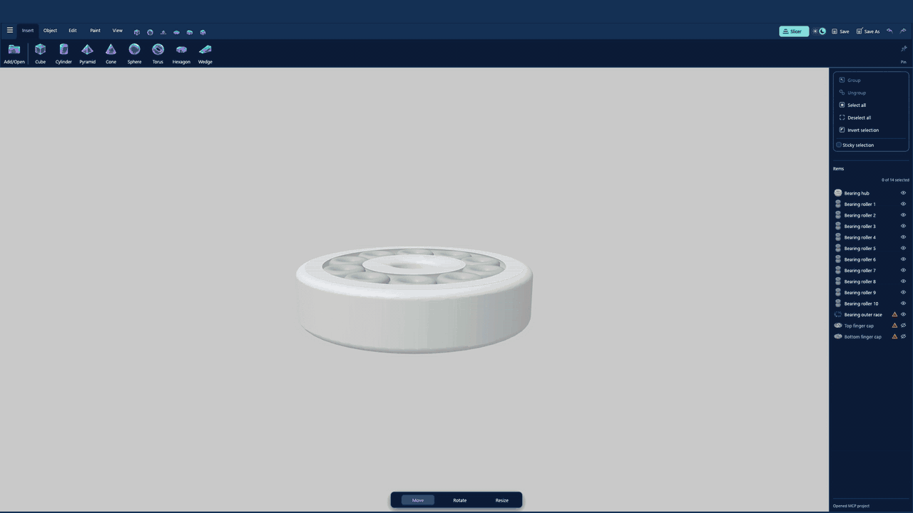
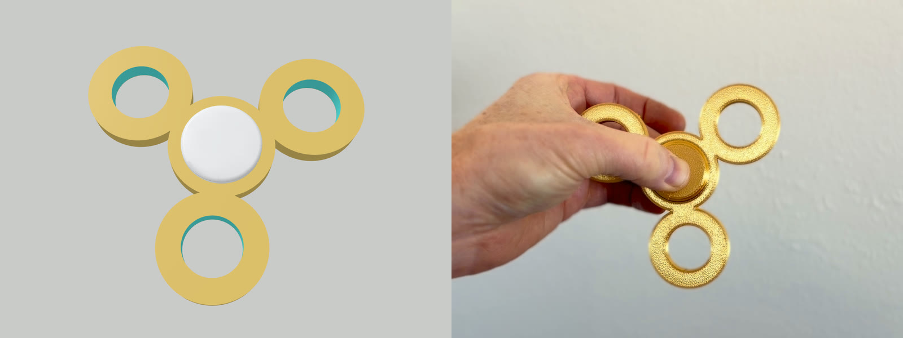
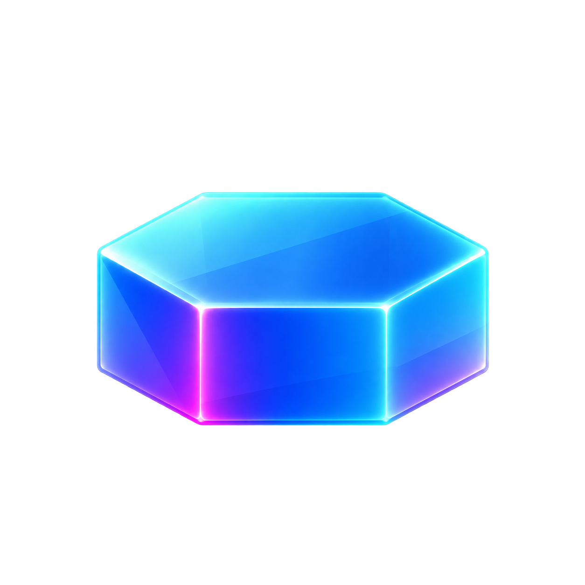
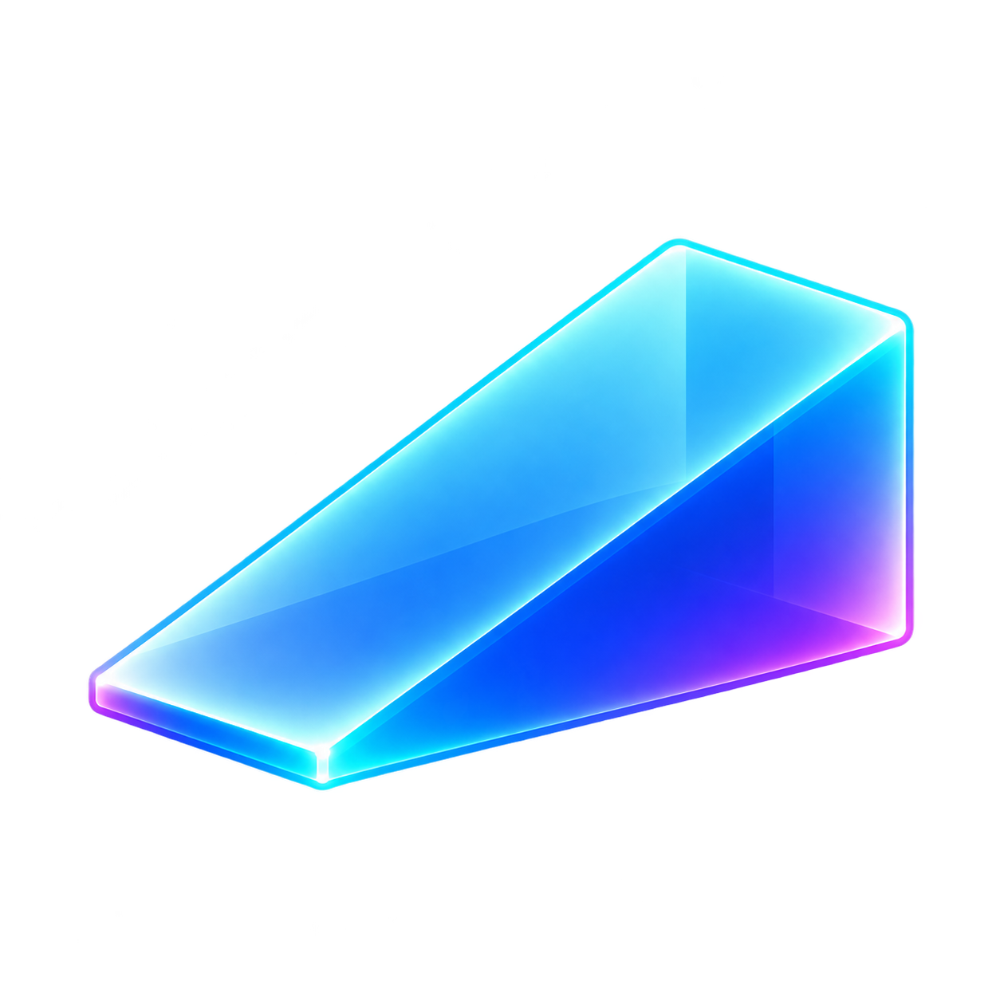
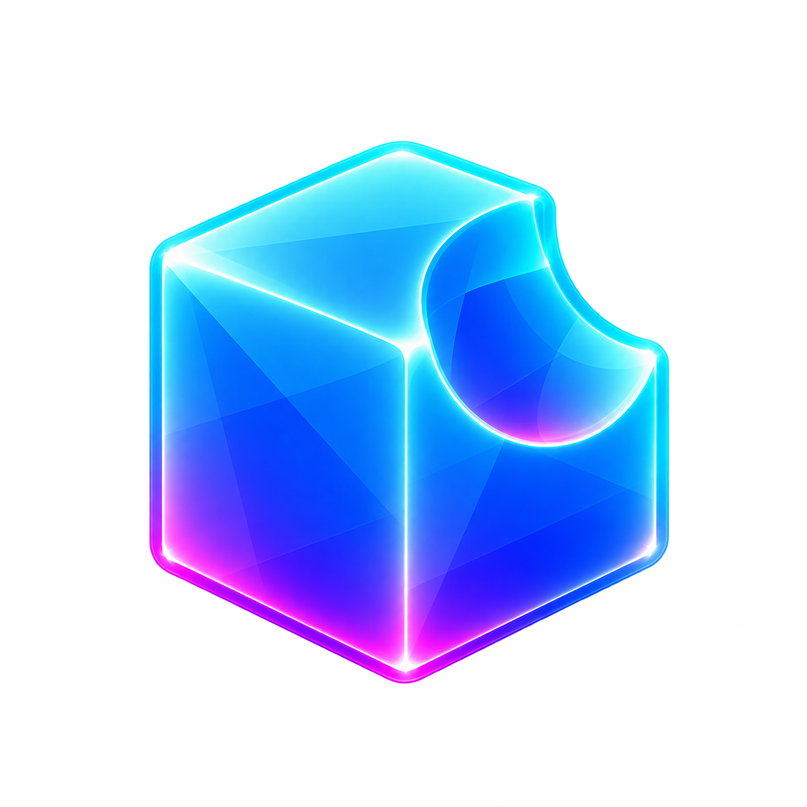
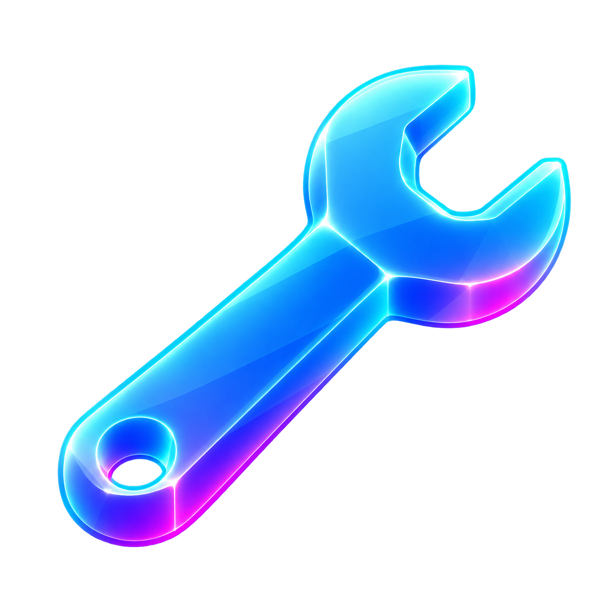
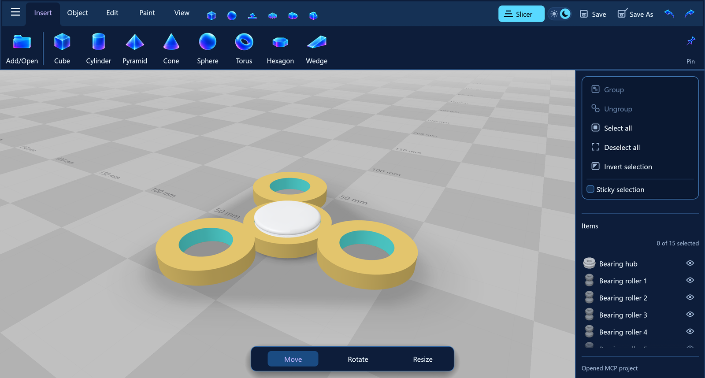
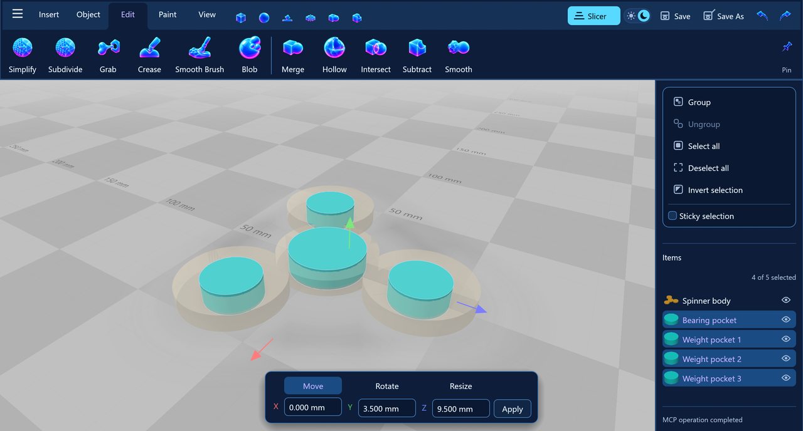
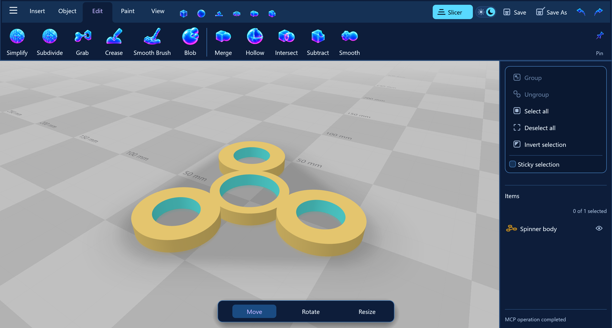
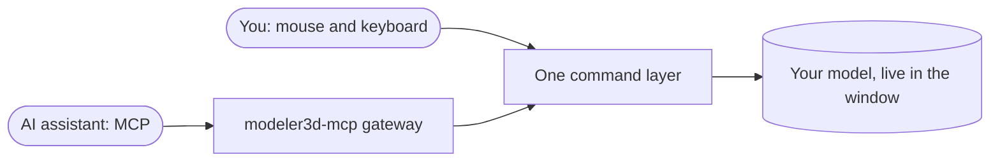

<p align="center">
  
</p>

<h1 align="center">3D Modeler</h1>

<p align="center">
  A simple, free 3D modeler for 3D printing. Windows, macOS and Linux.<br>
  Inspired by Microsoft 3D Builder, with an AI (MCP) server built in.
</p>

<p align="center">
  <a href="https://github.com/scotttheis/3D-Modeler/releases/latest"></a>
  <a href="https://github.com/scotttheis/3D-Modeler/actions/workflows/ci.yml"></a>
  <a href="LICENSE"></a>
  
  <a href="docs/mcp.md"></a>
</p>

<p align="center">
  <a href="https://github.com/scotttheis/3D-Modeler/releases/latest"></a>
  <a href="https://github.com/scotttheis/3D-Modeler/releases/latest"></a>
  <a href="https://github.com/scotttheis/3D-Modeler/releases/latest"></a>
</p>

<p align="center">
  <a href="docs/media/fidget-spinner.mp4"></a><br>
  <sub>Designed in 3D Modeler, printed, and spun. <a href="docs/media/fidget-spinner.mp4">Watch in full quality (MP4)</a>.</sub>
</p>

## From screen to hand

<p align="center">
  
</p>

The spinner body is just cylinders: a hub and three lobes merged into one
piece, then four more cylinders as cutters for the bearing pocket and the
weight holes. The bearing and finger caps were imported as 3MF to check the
fit. One Subtract, one 3MF export, and it went to the printer.

<table align="center"><tr><td align="center"><br><sub>Cube</sub></td><td align="center"><br><sub>Cylinder</sub></td><td align="center"><br><sub>Pyramid</sub></td><td align="center"><br><sub>Cone</sub></td><td align="center"><br><sub>Sphere</sub></td><td align="center"><br><sub>Torus</sub></td><td align="center"><br><sub>Hexagon</sub></td><td align="center"><br><sub>Wedge</sub></td></tr></table>

<table align="center"><tr><td align="center"><br><sub>Merge</sub></td><td align="center"><br><sub>Subtract</sub></td><td align="center"><br><sub>Intersect</sub></td><td align="center"><br><sub>Hollow</sub></td><td align="center"><br><sub>Repair</sub></td><td align="center"><br><sub>Material</sub></td></tr></table>

## Why

3D Builder was the easiest way to make something printable. It is gone from
most computers and never ran outside Windows. 3D Modeler keeps the same idea:
add shapes, move them, combine them, check them, print them. Nothing has to be
learned first. It is a small desktop app written in Rust, with no account and
no tracking.

## What it does

- **Shapes:** cube, cylinder, pyramid, cone, sphere, torus, hexagon and wedge.
- **Move, rotate and resize** with on-screen arrows or typed numbers in millimetres.
- **Combine:** Merge, Subtract and Intersect. Select one object and click
  Subtract to cut away everything it touches.
- **Edit meshes:** Grab, Smooth, Crease, Blob, Simplify, Subdivide, Hollow, Mirror, Align.
- **Print check:** finds holes and other problems and can repair them.
- **Look:** colours, textures, paint, X-ray and wireframe, light and dark themes.
- **Files:** opens and saves `.3dp` projects; imports and exports STL, OBJ, PLY,
  3MF, glTF/GLB and VRML (WRL).
- **Send to your slicer** from the toolbar.
- **AI built in:** an MCP server lets an assistant such as Claude use the same
  tools you do. See [`docs/mcp.md`](docs/mcp.md).

<p align="center">
  <picture>
    <source media="(prefers-color-scheme: light)" srcset="docs/images/window-light.png">
    
  </picture><br>
  <sub>Light and dark themes. This picture follows your GitHub theme.</sub>
</p>

### Cut with one click

Place cutter shapes where you want holes, then **Subtract**. X-ray shows what
will be cut before you commit.

| Before: cutters in X-ray | After: one Subtract |
|---|---|
|  |  |

## Download

Get the installer for your system from the
[Releases page](https://github.com/scotttheis/3D-Modeler/releases/latest).

| System | File | Notes |
|---|---|---|
| Windows | `3D-Modeler-<version>-windows-x86_64.msi` | Not code-signed, so Windows SmartScreen shows "More info", then "Run anyway". |
| macOS | `3D-Modeler-<version>-macos-universal.dmg` | Not notarized. Right-click the app, choose Open, then Open again. |
| Linux | `3D-Modeler-<version>-linux-x86_64.tar.gz` | Unpack it and run the installer script or launcher inside. |

The app checks GitHub once at startup for a newer version and asks before
downloading anything. Releases also carry `3D-Modeler-SHA256SUMS.txt` so you
can verify a download.

## Use it with an AI assistant

The AI (MCP) gateway is part of the app: every installer includes
`modeler3d-mcp` right beside 3D Modeler. Point your AI client at it while the
app is running and the assistant can use the same tools you click, live, in
the window you are looking at. The fidget spinner video at the top was built
this way.



There are four safety profiles (observe, model, files, full), and file access
is limited to folders you approve. Setup and the full tool list are in
[`docs/mcp.md`](docs/mcp.md).

## Build from source

<details>
<summary>Rust toolchain, C toolchain and libclang</summary>

You need the Rust toolchain pinned in `rust-toolchain.toml`, a C toolchain and
libclang. See [`docs/building.md`](docs/building.md).

```
cargo build --release
target/release/modeler3d-app
```

On Windows, run `scripts/Initialize-BuildClang.ps1` in the same PowerShell
session before Cargo. Run the tests with `cargo test --workspace`.

</details>

## Status

Version 1.0 is out. Known limits:

- **Repair works best on Windows.** On Windows, Repair uses the advanced
  3D-printing repair engine built into Windows itself. Mac and Linux don't
  have that engine, so 3D Modeler uses its own repair there. It fixes common
  problems such as holes and flipped faces well, but on badly damaged models
  it may not be as thorough as the Windows engine.
- Very dense models (hundreds of thousands of faces) can still make the window
  pause for a few seconds during a boolean operation.

Current work is tracked in [`docs/STATUS.md`](docs/STATUS.md) and changes in
[`CHANGELOG.md`](CHANGELOG.md).

## Contributing

Bug reports are very welcome. Because the product stands on extreme
simplicity, new features and look changes are considered one at a time. Read
[`CONTRIBUTING.md`](CONTRIBUTING.md) first. Security problems: see
[`SECURITY.md`](SECURITY.md).

## Support

3D Modeler is free and always will be. If it's useful to you, you can help
keep the updates and new features coming by
[supporting it on Ko-fi](https://ko-fi.com/scotttheis). Thank you!

<a href="https://ko-fi.com/scotttheis"></a>

If you like it, a ⭐ on GitHub helps other people find it.

## Licence

Licensed under the Apache License, Version 2.0. See [`LICENSE`](LICENSE) and
[`THIRD_PARTY_NOTICES.md`](THIRD_PARTY_NOTICES.md).

## Disclaimer

3D Modeler is an independent project. It is not affiliated with, endorsed by
or sponsored by Microsoft. 3D Builder is a trademark of Microsoft Corporation.
